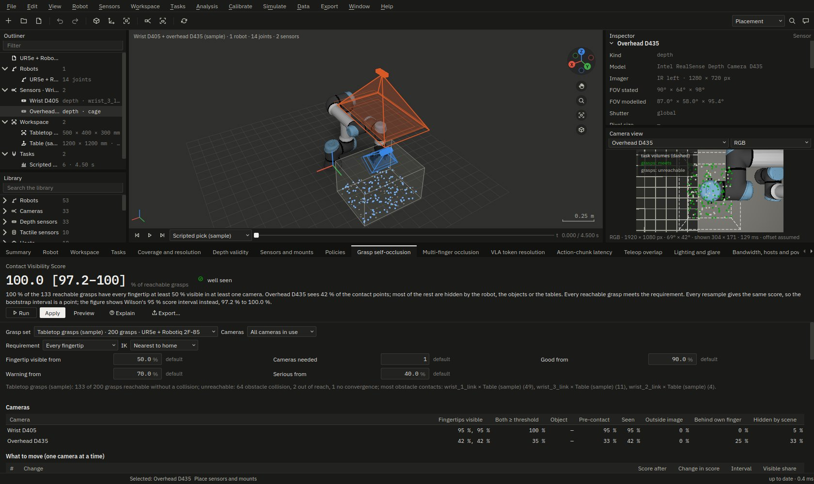
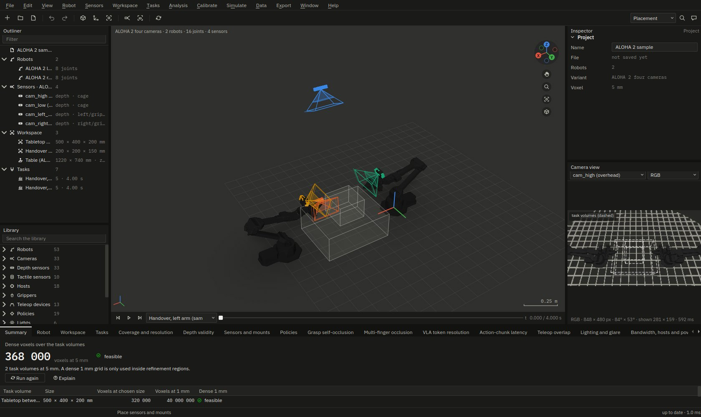
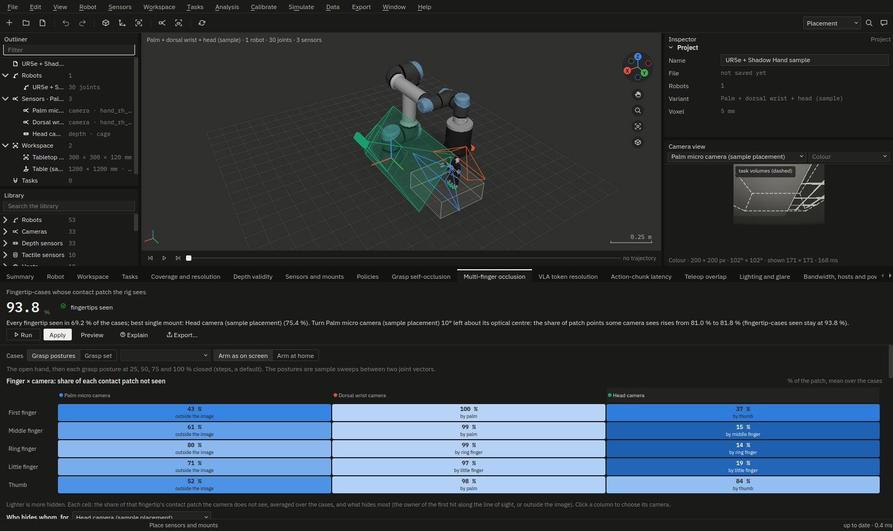
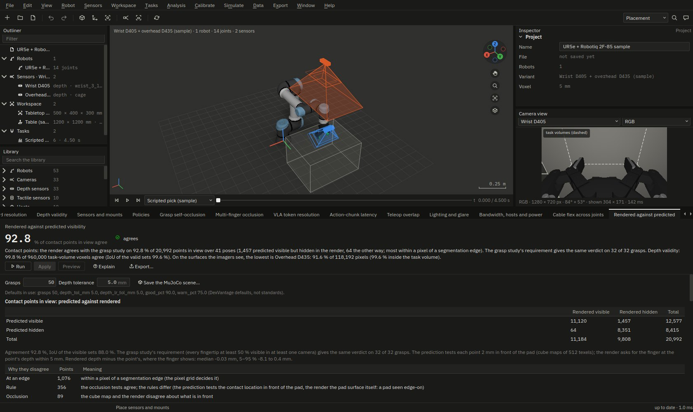
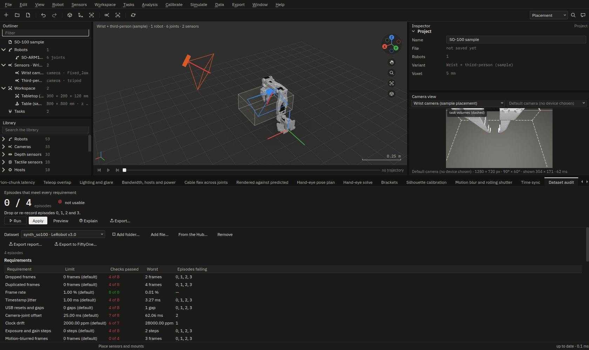
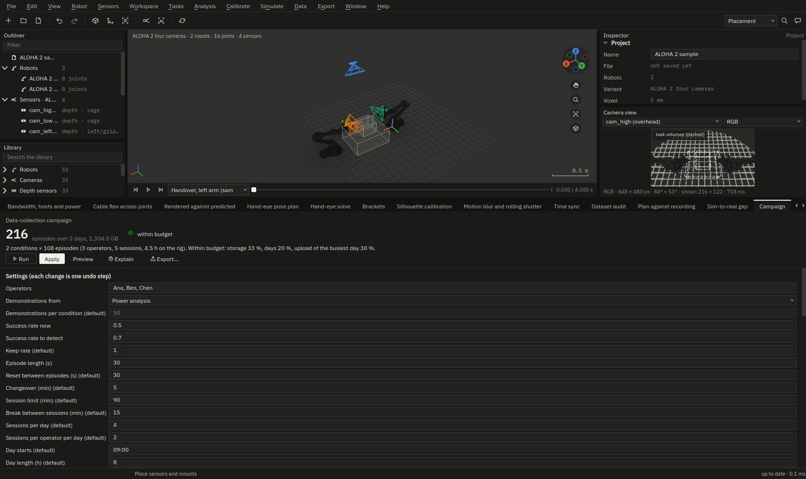

# DexVantage · camera, depth and teleop planning for robot-learning data collection

DexVantage is a desktop application for robotics R&D teams who build manipulation and humanoid robots and collect
demonstrations for robot-learning policies (ACT, Diffusion Policy, and VLA models such as OpenVLA, π0 and GR00T). It
answers, before a lab builds or changes its rig and again after the rig has recorded:

- where the wrist, head, chest, overhead and third-person cameras go so that the fingertips, the object and the
  contact point are visible at the moment of grasp;
- whether depth is valid where the policy needs it (inside the stereo minimum range, in the gripper's shadow, on a
  glossy or transparent surface);
- whether the teleoperator can reach poses the follower cannot, and whether the cables, the USB or GMSL host and the
  clocks keep up;
- whether the hand-eye calibration is observable from the planned poses, and how uncertain it will be;
- whether a recorded dataset (LeRobot, RLDS / Open X-Embodiment, ROS 2 MCAP) meets the plan;
- what to export to MuJoCo, Isaac Lab, LeRobot and ROS 2 so that simulation and training see the same cameras as the
  real rig.

**Who it is for:** the people who design, build and run robot data-collection cells: robot-learning researchers, the
lab engineers who mount the cameras and route the cables, and the teams who audit the datasets afterwards. It is
built for a workstation (Windows, macOS, Linux) and for batch mode on a CI runner or a Jetson; so far it has run on
Linux x86_64 only ([known limits](#known-limits)).

It is the sibling of Vantage, the sensor-rig planner for autonomous-driving data collection, with the same design
language and engineering standards: every number comes from a model that a validation check compares with an
independent reference, every hardware figure comes from a cited datasheet or is shown as "not stated by the maker",
and every export carries a provenance block.

**Website:** <https://sherin-sef-ai.github.io/DexVantage/>, built from [`site/`](site/) and published by
[`.github/workflows/pages.yml`](.github/workflows/pages.yml) once GitHub Pages is turned on for the repository. It
holds the user guide, the models and methods, the technical reference and the validation report.



*The grasp self-occlusion page on the UR5e + Robotiq 2F-85 sample: the Contact Visibility Score with its interval,
what each camera sees of the fingertips, and the camera move that would raise the score.*

> **Status: release candidate 0.1.0rc1, not yet released.** Phases 0–11 and research tools parts 1 and 2 are done.
> At the final Phase 11 gate (2026-11-08) 3 991 tests passed, 232 of 232 validation checks
> passed and 46 of 46 self-test lines were ok ([docs/BUILD_STATE.md](docs/BUILD_STATE.md)).
> Nothing has been tagged or released.

## Install

### From a bundle (no Python needed)

The bundles carry their own Python, Qt and MuJoCo libraries. They will be **available from the
[release page](https://github.com/Sherin-SEF-AI/DexVantage/releases/latest) once released**; until then, install
from source.

| System | File | Needs |
|---|---|---|
| Windows | `DexVantage-<version>-windows-x64-setup.exe` (installs for the current user, no administrator rights) or `DexVantage-<version>-windows-x64.zip` | Windows 10 or 11, x64 |
| macOS | `DexVantage-<version>-macos-arm64.zip` | Apple silicon |
| Linux x86_64 | `DexVantage-<version>-linux-x86_64.tar.gz` (a folder with `install.sh`, which adds a menu entry for the current user) | x86_64, glibc 2.35 or later (Ubuntu 22.04 or later) |
| Linux arm64 (NVIDIA Jetson) | `DexVantage-<version>-linux-arm64.tar.gz` | arm64 with glibc 2.35 or later, such as a Jetson Orin with JetPack 6 or 7 |

Each release will also carry `SHA256SUMS.txt`. The bundles are not code-signed: Windows SmartScreen asks you to
confirm (*More info ▸ Run anyway*), and on macOS the first start needs *System Settings ▸ Privacy & Security ▸ Open
Anyway*. After installing, `dexvantage --self-test` checks the installation without opening a window.

### From source (pip)

Python 3.10 or newer, on any of the systems above.

```bash
git clone https://github.com/Sherin-SEF-AI/DexVantage
cd DexVantage
python3 -m venv .venv
.venv/bin/pip install -e .                 # Windows: py -m venv .venv, then .venv\Scripts\pip install -e .
.venv/bin/dexvantage --self-test
```

Optional extras add features; install the ones you need, for example `.venv/bin/pip install -e ".[lerobot,bags,usd]"`:

| Extra | Adds |
|---|---|
| `lerobot` | LeRobot Parquet and AV1/MP4 datasets (pyarrow, PyAV) |
| `bags` | compressed ROS 2 bags (MCAP chunks with zstd or lz4) |
| `usd` | the OpenUSD robot import and the Isaac camera prims (usd-core) |
| `pin` | pinocchio, a second kinematics backend and a validation reference: with pin 4.1.0 its forward kinematics agreed with DexVantage's within 9.57 × 10⁻¹⁶ m (`kinematics.fk_pinocchio`, a fresh install on 2026-11-08); its IK backend for the grasp study reads URDF robots only, so not the bundled samples (MJCF) |
| `step` | bracket export as a STEP solid (gmsh) |
| `rerun` | the Rerun bridge (rerun-sdk) |
| `assistant` | the Assistant dock's Claude provider, with keys in the system keyring |
| `research` | `Result.to_frame()` of the Python API as a pandas DataFrame |
| `tracking` | the experiment tracker's MLflow and W&B exports, read back by their own clients |
| `test` | pytest, ruff and the test references |
| `site` | `scripts/build_site.py`: the website's generated pages and images |

## Quick start

```bash
dexvantage --sample aloha                          # the window, with the ALOHA 2 sample open
dexvantage --sample ur5e --analyse -               # a sample's project summary as JSON, in batch mode
dexvantage --sample ur5e --grasp grasp.json        # grasp self-occlusion: the Contact Visibility Score
dexvantage --sample ur5e --coverage cov.json       # coverage and resolution of the task volume
dexvantage --sample ur5e --depth-validity dv.json  # where the wrist D405 and the overhead D435 give valid depth
dexvantage --sample ur5e --vla-tokens vla.json     # ViT tokens per fingertip for the sample's π0 (add an object to count it)
dexvantage --sample ur5e --groundtruth gt.json     # MuJoCo renders against the predicted visibility and depth
dexvantage --sample ur5e --export out/ --formats mjcf,urdf,opencv_yaml,isaac,lerobot,report
dexvantage --sample ur5e --check defaults sc.json  # the readiness scorecard as a CI gate: exit 0 pass, 1 fail, 2 error
dexvantage --validate out/validation               # the validation suite and its HTML report
python -c "import dexvantage as dv; print(dv.sample('ur5e').run('coverage').headline['text'])"
python -m dexvantage.mcp --project cell.dexv       # the MCP server over stdio, for an MCP client (or --sample NAME)
```

Every study has a batch flag (`dexvantage --help` lists them; the user guide's [batch chapter](docs/user-guide.md#13-batch-mode-batch)
and the generated [command-line reference](docs/reference/cli.md)) and a page in the window under **Analysis**. An
input a study cannot work with exits 2 with one plain sentence, never a traceback.

## Samples

Six samples open with `dexvantage --sample <id>` or **File ▸ Open sample**. The robots are MuJoCo Menagerie models,
bundled after their licences were read ([THIRD_PARTY.md](THIRD_PARTY.md)). Cameras sit where a project publishes them
and are labelled sample placements otherwise. Each sample has a tour in [docs/guide/samples.md](docs/guide/samples.md).

| `--sample` | Robot (Menagerie model, licence) | Cameras |
|---|---|---|
| `so100` | LeRobot SO-ARM100 (`trs_so_arm100`, Apache-2.0) | a wrist camera and a third-person camera (sample placements) |
| `ur5e` | UR5e + Robotiq 2F-85 (BSD-3-Clause and BSD-2-Clause) | a wrist RealSense D405 and an overhead D435 (sample placements) |
| `dexhand` | UR5e + Shadow Hand E3M5 (BSD-3-Clause and Apache-2.0) | a palm micro camera, a dorsal wrist camera and a head camera (sample placements) |
| `aloha` | ALOHA 2: two ViperX 300 arms (`aloha`, BSD-3-Clause) | `cam_high`, `cam_low` and the two wrist cameras, D405s where the published model puts them |
| `panda-bimanual` | two Franka Pandas with the Franka Hand (`franka_emika_panda`, Apache-2.0) | a wrist D405 on each hand and a front D435 (sample placements); there is no official bimanual Franka model, so this is two instances of the single-arm model in one cell |
| `g1` | Unitree G1 upper body with three-finger hands (`unitree_g1`, BSD-3-Clause; meshes simplified to within 0.5 mm) | the head D435 where Unitree's URDF puts `d435_link` |



## Features and measured figures

Every figure below was measured, and the last column says where. Validation figures are from the full run of
`dexvantage --validate` at the final gate (232 of 232 checks; report dated 2026-11-08 UTC; Linux x86_64, Python
3.14.4, MuJoCo 3.17.0, OpenCV 5.0.0). Each check compares a model with an independent reference, and the figure is the
largest difference it measured. The validation report (`site/validation.html`, on the website) lists every check with
its tolerance and the reason for it.

| Feature | Measured | Where measured |
|---|---|---|
| Robots from URDF, MJCF, USD and MuJoCo Menagerie; forward kinematics | 8.74 × 10⁻¹⁵ m between MuJoCo and an independent product-of-exponentials chain | check `kinematics.fk_poe_mujoco`; [robots.md](docs/models/robots.md) |
| Inverse kinematics (damped least squares, limits, seeds, IK drag) | 9.97 × 10⁻⁵ m largest tool error over random reachable targets (tolerance 0.1 mm) | check `kinematics.ik_round_trip`; [ik.md](docs/models/ik.md) |
| Samples posed as their published models | ALOHA 2 arms against Menagerie's `aloha.xml`: 4.61 × 10⁻⁷ m; G1 head camera against Unitree's URDF: 2.22 × 10⁻¹⁶ m | checks `samples.aloha_arms`, `samples.g1_head_camera`; [samples.md](docs/models/samples.md) |
| Lens models (pinhole, Brown-Conrady, Kannala-Brandt and others) | 1.82 × 10⁻¹² px against OpenCV `projectPoints`; 0.1671 px against spheres rendered by MuJoCo | checks `optics.opencv_pinhole_brown`, `optics.mujoco_fiducial_centres`; [optics.md](docs/models/optics.md) |
| Occlusion by the posed robot (cube maps on the GPU, or numpy) | 0.001835 of random points differ from exact ray casting, both samples, every backend | check `occlusion.samples_vs_raycast`; [occlusion.md](docs/models/occlusion.md) |
| Coverage and resolution of the task volume (`--coverage`) | 8.85 × 10⁻⁴ of the volume against an independent projection and ray casting | check `occlusion.coverage_vs_raycast`; [coverage.md](docs/models/coverage.md) |
| Depth validity (`--depth-validity`): min-Z, finger shadows, projector cone, σ_z | Intel's D400 tables: 0 figures differ; σ_z against Monte Carlo: 0.006978 relative | checks `depth.d400_tables`, `depth.sigma_z_monte_carlo`; [depth.md](docs/models/depth.md) |
| Grasp self-occlusion and the Contact Visibility Score (`--grasp`) | 0 of the tested contact locations differ from exact ray casting; 2 000 grasps on the UR5e in 114.2 s on an RTX 5080 through EGL; ALOHA 2 182.1 s, over this project's 180 s default | check `grasp.visibility_vs_raycast`; [docs/performance.md](docs/performance.md) (2026-11-08) |
| MuJoCo ground truth (`--groundtruth`): renders against the predictions | contact points: 1 − agreement = 0.07246 (92.8 % agree) on the UR5e; depth voxels: 0.002227 (99.8 % agree) | checks `groundtruth.ur5e_contacts`, `groundtruth.ur5e_depth`; [groundtruth.md](docs/models/groundtruth.md) |
| VLA token resolution and Plücker ray maps (`--vla-tokens`) | 0 tokens differ from per-pixel ray casting, over three lens models and four crop rules | check `vla.patch_counts_raycast`; [vla.md](docs/models/vla.md) |
| Multi-finger occlusion matrix and tactile handoff (`--dex-occlusion`) | 0 of a pad's hidden share differs from the closed form | check `dexhand.matrix_vs_analytic`; [dexhand.md](docs/models/dexhand.md) |
| Bandwidth, hosts and power (`--bandwidth`) | 3.86 × 10⁻¹⁶ relative against the budget written out again from the library files | check `bandwidth.budget_recompute`; [bandwidth.md](docs/models/bandwidth.md) |
| Cable flex across joints (`--cables`) | 0 poses where the snag flag differs from brute force | check `cables.snag_bruteforce`; [cables.md](docs/models/cables.md) |
| Printable brackets (`--brackets`) | 0 mesh defects (closed, consistently oriented) | check `brackets.watertight`; [brackets.md](docs/models/brackets.md) |
| Hand-eye calibration: ChArUco and AprilGrid, AX = XB and AX = ZB, bundle adjustment, pose planner | rendered ChArUco corners 0.113 px (the worst view's RMS); planner σ against the bundle adjustment's: 0.008734 (ln of the ratio) | checks `handeye.charuco_render`, `handeye.planner_vs_ba`; [handeye.md](docs/models/handeye.md) |
| Targetless link-silhouette calibration (`--silhouette-calib`) | 1.659 px from the true mount on synthetic LeRobot episodes | check `handeye.silhouette_recovery`; [render_calib.md](docs/models/render_calib.md) |
| Teleop overlap and dead zones (`--teleop`) | 0 of the brute-force leader workspace missed | check `teleop.leader_workspace`; [teleop.md](docs/models/teleop.md) |
| Lighting, glare and IR wash-out (`--lighting`) | white furnace test 8.12 × 10⁻¹² | check `lighting.white_furnace`; [lighting.md](docs/models/lighting.md) |
| Motion blur and rolling shutter (`--motion-blur`) | 0.02381 of the motion against a row-by-row readout | check `blur.rolling_shutter_bruteforce`; [motion_blur.md](docs/models/motion_blur.md) |
| Action-chunk latency (`--action-chunk`) | 2.91 × 10⁻⁵ m against an event-by-event simulation | check `chunk.loop_vs_simulation`; [action_chunk.md](docs/models/action_chunk.md) |
| LeRobot v2.1 and v3.0 readers and writers, the ROS 2 bag reader (MCAP and SQLite) and MCAP writer, the RLDS reader | 0 mismatches, read back with pyarrow, json and ffmpeg | check `formats.lerobot_roundtrip`; [datasets.md](docs/models/datasets.md) |
| Dataset auditor (`--audit`) | fault recall and false positives: 0 shortfall against the stated floors; desync estimated within 16.87 ms | checks `audit.fault_recall`, `audit.desync_offset`; [audit.md](docs/models/audit.md) |
| Requirements and the readiness scorecard (`--check`) | 0 cases where a bound decision differs from a Monte Carlo | check `requirements.bound_decisions`; [requirements.md](docs/models/requirements.md) |
| Monte Carlo tolerances (`--tolerance-mc`) | σ against the GUM law of propagation: 0.006006 relative | check `tolerance.linear_propagation`; [tolerance.md](docs/models/tolerance.md) |
| Designed experiments and Sobol indices (`--experiment`) | 8.07 × 10⁻⁴ from the Ishigami function's analytic indices | check `experiments.sobol_ishigami`; [experiments.md](docs/models/experiments.md) |
| NSGA-II optimiser and design agent (`--optimise`) | ZDT1 inverted generational distance 0.005111 | check `optimise.zdt1_igd`; [optimise.md](docs/models/optimise.md) |
| Exporters: MJCF, URDF and tf, OpenCV and Kalibr, Isaac Lab and USD, LeRobot, masks, report | URDF through urdfdom's rules and MuJoCo: 1.07 × 10⁻¹⁵ m; Isaac camera prims through pxr: 2.56 × 10⁻⁵ px | checks `formats.urdf_roundtrip`, `formats.isaac_usd`; [exporters_a.md](docs/models/exporters_a.md), [exporters_b.md](docs/models/exporters_b.md) |
| USD robot import | a third party's USD UR5e against the sample: 2.62 × 10⁻⁸ m | check `robot_io.usd_third_party`; [robot_io.md](docs/models/robot_io.md) |
| Assistant dock and MCP server | 0 non-conforming MCP replies or schemas; the number check: 0 wrong answers on a labelled corpus | checks `assistant.mcp_conformance`, `copilot.number_check`; [mcp.md](docs/models/mcp.md) |
| Statistics and power analysis (`--stats`) | 4.62 × 10⁻⁷ from the G*Power manual's examples | check `stats.power_gpower`; [stats.md](docs/models/stats.md) |
| Data-collection campaign planner (`--campaign`) | 0 violations of the Williams-square definition | check `campaign.williams_square`; [campaign.md](docs/models/campaign.md) |
| Sim-to-real gap (`--sim2real`) | four injected gaps recovered, the worst at 0.6783 of its tolerance | check `sim2real.injected_recovery`; [sim2real.md](docs/models/sim2real.md) |
| Publication kit (`--formats paper_kit`) | 0 table cells differ from their source value | check `publication.table_numbers`; [paper_kit.md](docs/models/paper_kit.md) |
| Experiment tracker (`--track`) | 0 fields read back otherwise by MLflow's client | check `tracking.mlflow_reader`; [tracking.md](docs/models/tracking.md) |
| Cluster sweeps (`--jobs`, `--slurm`) | 0 values differ between the gathered shards and the serial run | check `cluster.gather_equals_serial`; [cluster.md](docs/models/cluster.md) |
| Multi-cell comparison (`--cells`) | a known rotation recovered within 3.55 × 10⁻¹⁴ ° | check `cells.gap_rotation`; [cells.md](docs/models/cells.md) |
| UI responsiveness (the budget: no UI-thread step over 100 ms) | the 18 studies each sample's pages run, on the six samples: 0 steps over 100 ms, slowest 79.6 ms (SO-100, motion blur); a UR5e frame after a joint change: 67.6 ms median, 95.5 ms worst (shader renderer, integrated GPU) | `scripts/benchmarks.py --only ui`, [docs/performance.md](docs/performance.md) (2026-11-08); `scripts/measure_ui.py`, [models/performance.md](docs/models/performance.md) (2026-11-06) |

## Screenshots

| | |
|---|---|
|  |  |
| Multi-finger occlusion (UR5e + Shadow Hand): which finger hides which contact patch from which camera. | MuJoCo ground truth (UR5e): the rendered against the predicted visibility of the contact points. |
|  |  |
| The dataset audit of a synthetic SO-100 campaign with injected faults. | A data-collection campaign plan on the ALOHA 2 sample. |

The screenshots were taken from the application by `scripts/screens.py`.

## Known limits

The main ones follow; each model's document has its own "Known limits" section, and
[docs/BUILD_STATE.md](docs/BUILD_STATE.md) lists every open issue.

- **Not run against the real programs:** Isaac Lab and Isaac Sim, LeRobot's own loader and trainer, ACT, Diffusion
  Policy, OpenVLA, Kalibr and FiftyOne were not installed while building; the exports follow the cited formats and
  are read back by independent readers. No request was sent to a live Claude or Groq API (the tests use a fake
  provider).
- **Platforms:** everything here was built and tested on Linux x86_64 with Python 3.14 only (the other versions from
  3.10 that `pyproject.toml` allows have not been run; CI, set up for 3.12 and 3.14 on Linux, Windows and macOS, has
  not run yet). The dependencies have lower bounds only: it was tested with MuJoCo 3.17.0, PyQt6 6.12, NumPy 2.5 and
  OpenCV 5.0. MuJoCo 4.0.0 (2026-11-06), which pip now installs, passed the 232 validation checks in one run at the
  final gate (24 errors changed from 3.17.0's, all at round-off); the tests have not been run with it.
  Only the Linux x86_64 bundle has been built, on glibc 2.43, which it then needs; the Windows, macOS and Linux arm64
  bundles, and the glibc 2.35 Linux builds the table above describes, are built by CI only and none has been built or
  released ([docs/packaging.md](docs/packaging.md)).
- **Speed off Linux:** the GPU cube maps need Linux EGL; elsewhere the occlusion studies use the NumPy rasteriser,
  15–270 × slower per 512-texel cube map on the samples ([docs/performance.md](docs/performance.md)). On Linux the 2,000-grasp
  study on ALOHA 2 took 182.1 s against this project's 180 s default.
- **MuJoCo renders off Linux:** DexVantage renders MuJoCo scenes through EGL only, so on Windows and macOS the
  ground-truth study, the synthetic episodes, the silhouette calibration, the sim-to-real gap and the rendered
  validation checks stop with "MuJoCo cannot render offscreen through EGL on this machine" (the other studies do not
  render MuJoCo scenes; nothing has been run on Windows or macOS yet).
- **Window:** the QPainter 3D fallback (no OpenGL, or `--software-3d`) takes 0.16 s (SO-100) to about 1.4 s (ALOHA 2) a
  frame ([troubleshooting](docs/user-guide.md#troubleshooting)), over the 100 ms
  budget; there is no global exception hook, so an unexpected error inside a Qt slot (none seen) ends the window
  instead of being explained.
- **Hardware figures:** most makers state no lens distortion, readout time, sensitivity or processing latency, so
  built-in imagers are pinhole models fitted to the stated FOV, and smear, saturation and sync figures are bounds
  until you enter measured values. 81 library entries state a cited price; the rest read "not stated".
- **Grasps:** the fingers stay at their home opening and obstacles are not checked along the approach; the dexterous
  hand postures are sample sweeps, not measured synergies; mimic joints (the 2F-85's linkage) move independently.
- **Ground truth:** MuJoCo renders agree with the predictions on 92.8 % (UR5e) and 84.2 % (SO-100) of the contact
  points in view (on the UR5e most disagreements lie within a pixel of a segmentation edge); distorted lenses render
  slowly.
- **Calibration:** end to end from rendered images, the hand-eye error is about 2–2.5 × the predicted σ (treat σ as a
  lower bound); the automated comparison with OpenCV's hand-eye solvers cannot run on OpenCV 5.0.0, which has no
  `calibrateHandEye` binding.
- **Data:** the auditor does not resolve clock drift within an episode; RLDS carries no timestamps or calibration.
- **Robots:** xacro must be expanded to URDF first; a USD file holds one articulation; free and ball joints are held
  at home; the G1 sample's legs are held at its stand pose.
- **Optimiser:** the default budgets give a coarse front (105 s and 237 s on the UR5e).

## Documentation

- [docs/user-guide.md](docs/user-guide.md): the step-by-step guide, from the ten-minute tour to research workflows,
  with a worked example for every feature (longer ones in [docs/guide/](docs/guide/)) and its figures checked against
  the code; the generated [command-line](docs/reference/cli.md) and [Python API](docs/reference/api.md) references.
- [docs/overview.md](docs/overview.md): every model with its equations, references, validation and limits, with one
  document per model in [docs/models/](docs/models/).
- [docs/project-format.md](docs/project-format.md) and [docs/project.schema.json](docs/project.schema.json): the
  `.dexv` project file. [CHANGELOG.md](CHANGELOG.md): what changed.
- [docs/DEVELOPING.md](docs/DEVELOPING.md): the rules for contributors, how to run the tests, and where to add a
  study, a page, an exporter or a validation check.
- The website: `python scripts/build_site.py` writes its pages from these documents, `--validation` the validation
  page from `out/validation`, `--media` the images from `out/screens`; `--check` checks its links and HTML.

## Citation

If you use DexVantage in your research, please cite it with the metadata in [CITATION.cff](CITATION.cff) (GitHub's
"Cite this repository" gives APA and BibTeX from it). The publication kit (`--formats paper_kit`) writes a methods
paragraph with the DexVantage version and commit and a `refs.bib` with exactly the entries it cites.

## Licence

DexVantage is free software under the GNU General Public License, version 3 or later
([GPL-3.0-or-later](LICENSE)). Third-party components, robot models and fonts, with their licences and versions, are
listed in [THIRD_PARTY.md](THIRD_PARTY.md). Robot, camera and policy names describe the samples and the hardware
library and belong to their owners; no affiliation is implied.
