# Sample projects

Six samples open in this build: SO-100, UR5e + Robotiq 2F-85, the UR5e with a Shadow Hand for the multi-finger
occlusion study ([dexhand.md](dexhand.md)), ALOHA 2, two Franka Pandas in one cell, and the Unitree G1 upper body
(the last three: [the model page](../models/samples.md)). Each has a short tour below: open it, look, run one or two
studies and read what they say. The figures in the tours are produced by `scripts/guide_examples.py` (examples
`tour-<sample>`) on this build and checked against this page by `tests/test_guide_examples.py`; the screenshots are from
`out/screens` (`scripts/screens.py --only samples`, copied by `scripts/tour_media.py`). The ALOHA 2 sample also has the
[ten-minute tour](../user-guide.md#ten-minute-tour) of the user guide.

    dexvantage --sample so100                    # in the window (or File ▸ Open sample in a running window)
    dexvantage --sample ur5e --analyse -         # in batch mode: the project summary as JSON on standard output
    dexvantage --sample aloha --grasp out.json   # any study flag works on any sample

The robots are MuJoCo Menagerie models bundled with DexVantage after their own licences were read
(`THIRD_PARTY.md`; each model folder under `dexvantage/resources/robots/` keeps its `LICENSE`). Joint limits, link
geometry and the home pose are the model files' own. **Camera placements are sample placements** chosen so the rig has
something to analyse, not published figures: move them to where your cameras are.

## SO-100 (`--sample so100`)

- **Robot:** the SO-ARM100 from Menagerie `trs_so_arm100` (Apache-2.0), at the file's `home` keyframe. The arm
  reaches along the base frame's −y axis, as the file defines it; the world frame is the robot's base (REP-103).
  Its joint limits are the ones Menagerie added as "approximate joint limits" (the model's README), not The Robot
  Studio's figures; the robot's source note says so.
- **Gripper frame:** the `Fixed_Jaw` body; fingertips `Fixed_Jaw` and `Moving_Jaw`.
- **Cameras:** "Wrist camera (sample placement)" on `Fixed_Jaw`, on a bracket 0.06 m behind the jaws on the wrist
  side, looking down past the jaw tips; "Third-person camera (sample placement)" on a tripod in front of and beside
  the table, looking at the task volume. Neither has a library device: no maker in the library states a camera for
  the SO-100, so both use the labelled default camera (pinhole, 1280 × 720 px, 90° × 60°) until you choose one on
  the Sensors page.
- **Workspace:** a 0.30 × 0.20 × 0.12 m tabletop volume under the jaw tips at home.
- **Tasks and policy (sample choices):** the grasp set "Top-down pinches over the tabletop (sample)" (100 top-down
  pinches sampled over the volume, seed 0; the five-joint arm cannot hold most side grasps) and the policy "SmolVLA
  (sample)" (its paper evaluates on SO-100 rigs), so the grasp self-occlusion and VLA token studies run as the sample
  opens (`--grasp`, `--vla-tokens`). SmolVLA's inference time is not stated by its source, so `--action-chunk`
  refuses until you enter a measured one on the Policies page.
- **Teleop device (sample choice):** "SO-100 leader arm (sample)": the leader is the follower's own model, joint to
  joint, as the LeRobot SO-100 guide builds it, so `--teleop` runs as the sample opens (96.7 % teleoperable).

### Tour

<!-- example: tour-so100 -->
1. `dexvantage --sample so100` (or File ▸ Open sample ▸ LeRobot SO-100 arm with a wrist and a third-person camera).
   The Outliner lists 1 robot, 2 sensors, the tabletop volume and the grasp set.

   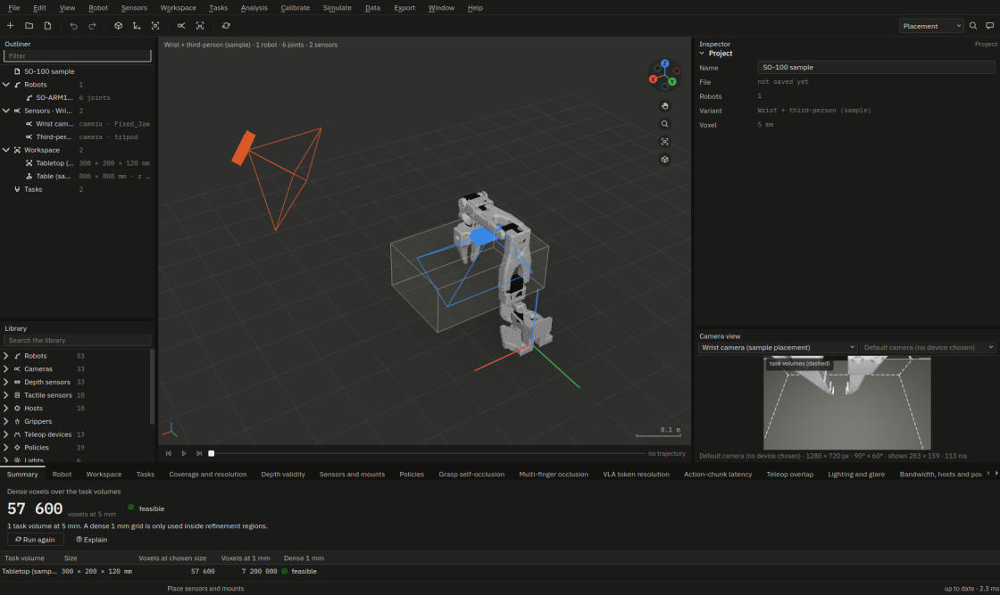

2. Robot ▸ Joint sliders and move `Rotation` (the base): the wrist camera's frustum rides with the jaw, the tripod
   camera stays put, and the Camera view follows the wrist camera when it is selected.
3. Analysis ▸ Coverage and resolution ▸ Run: "Task volume seen: 94.5 % (gaps)". The camera table says which camera
   misses what; the two default cameras (no device chosen) leave gaps a second view would close.
4. Analysis ▸ Grasp self-occlusion ▸ Run (the 100 top-down pinches): "Contact visibility: 100 % (well seen)".
5. Analysis ▸ Teleop overlap ▸ Run (the leader arm): "Teleoperable task volume: 96.7 % (clear)"; Apply moves the
   follower's base by the suggested step.

   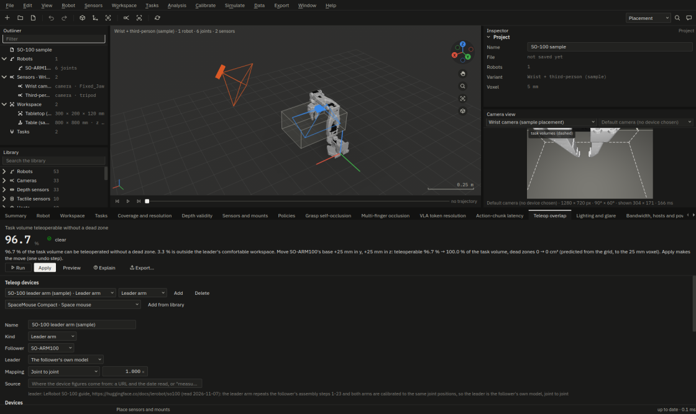

The SO-101 is in Menagerie too (`robotstudio_so101`, Apache-2.0, 18 MB of
meshes, not bundled): Robot ▸ Import from MuJoCo Menagerie downloads it and shows its licence first.

## UR5e + Robotiq 2F-85 (`--sample ur5e`)

- **Robot:** the UR5e (`universal_robots_ur5e`, BSD-3-Clause) with the 2F-85 (`robotiq_2f85`, BSD-2-Clause) on its
  flange. `ur5e_robotiq_2f85.xml` was written by MuJoCo itself: `MjSpec.attach` of the gripper at the UR5e file's
  `attachment_site`, names prefixed `gripper_` (`scripts/bundle_menagerie.py`). A test checks the gripper's pose
  against the two separate files compiled by MuJoCo.
- **Gripper frame:** `gripper_base` (the body with the file's `pinch` site); fingertips `gripper_right_pad` and
  `gripper_left_pad`.
- **Sensors:** "Wrist D405", a depth camera on `wrist_3_link`, 0.07 m off the tool axis, looking at the pinch point;
  "Overhead D435", a depth camera on the cage 0.85 m above the task volume, looking straight down. Both name
  their library entries (`intel-realsense-d405`, `intel-realsense-d435`): lenses, depth FOV, baseline, the
  minimum-Z table and the stated RMS error come from Intel's D400 series datasheet (Rev 023, read 2026-11-06). Where
  Intel states no offset (the D435's RGB imager, the projector) the entry places it as a labelled assumption.
- **Workspace:** a 0.50 × 0.40 × 0.30 m tabletop volume under the gripper at home.
- **Tasks and policy (sample choices):** the grasp set "Tabletop grasps (sample)" (200 grasps: top-down, side and
  angled, seed 0) and the policy "π0 (sample)", so every Phase 3, 6 and 7 batch flag runs on it: `--grasp`,
  `--vla-tokens`, `--bandwidth`, `--cables`, `--brackets`, `--handeye-plan`. There is no task object: add one to
  count its tokens and its grasp region. A scripted pick trajectory ("Scripted pick (sample)", 4.5 s) gives the motion
  blur, time sync and action-chunk studies their motion (`--motion-blur`, `--time-sync`, `--action-chunk`).
- **Not in the samples:** lights (`--lighting` says "no lights": the lighting guide adds a key light and a window),
  a set exposure (smear figures are upper bounds) and, on the UR5e and dexhand samples, a teleop device.
- **Geometry:** the Menagerie UR5e rounds its link offsets to the millimetre, so its flange is up to 1.3 mm from
  the flange of Universal Robots' DH table ([robots.md](../models/robots.md#known-limits)).

### Tour

<!-- example: tour-ur5e -->
1. `dexvantage --sample ur5e`: 1 robot, 2 sensors (both depth cameras, one on a link). Analysis ▸ Run the project
   summary (F5) fills the Summary tab.

   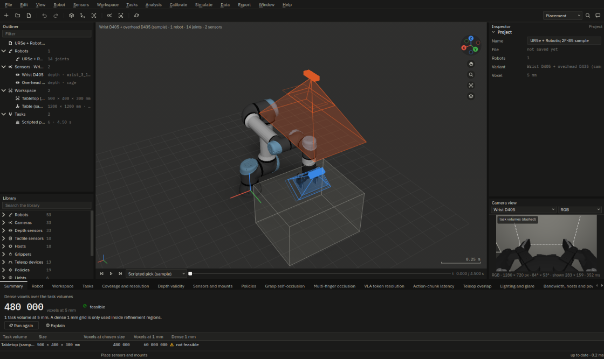

2. Turn the shoulder on the Robot page: the wrist D405 follows the flange, the overhead D435 does not.
3. Coverage ▸ Run: "Task volume seen: 91.9 % (mostly single or blind)". Depth validity ▸ Run: "Depth-valid task
   volume: 84.6 %".
4. Grasp self-occlusion ▸ Run (the 200 tabletop grasps): "Contact visibility: 100 % (well seen)", with the gallery of
   the weakest grasps as each camera renders them.

   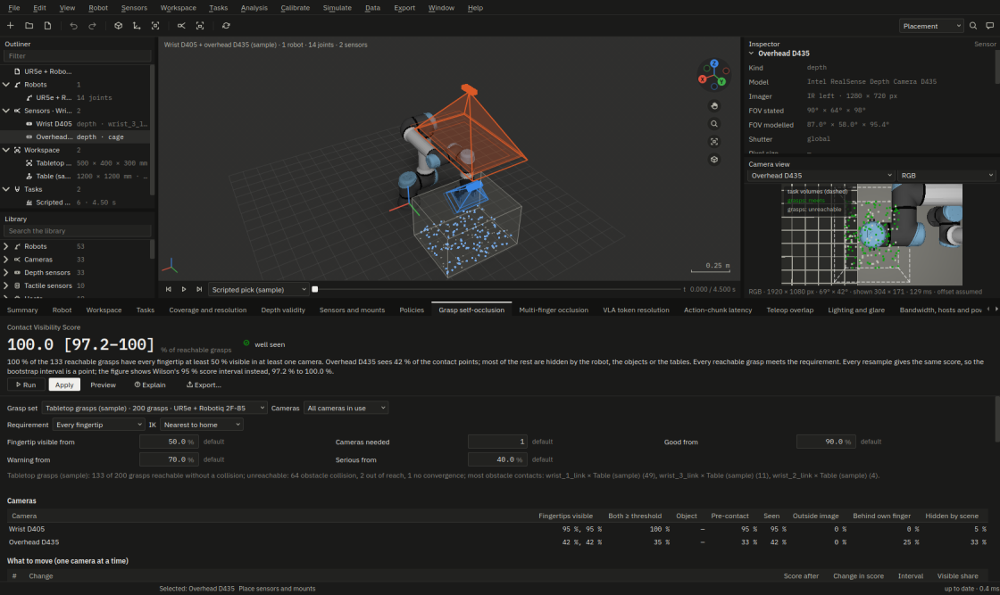

5. Time sync ▸ Run: "Worst camera to joint-state skew: ≥ 54.4 ms (out of sync)": the cameras are free-running
   against the joint states, and the page suggests the D435's hardware trigger.

Known limits: the 2F-85's linkage joints are separate entries of the joint vector, so moving one finger joint alone
poses the linkage in a way the real gripper cannot (the coupling is an equality constraint in the file, which
kinematics does not apply).

## UR5e + Shadow Hand (`--sample dexhand`)

- **Robot:** the UR5e with the right Shadow Dexterous Hand from Menagerie (`shadow_hand`, Apache-2.0) on
  its flange, one robot of 30 joints ([dexhand.md](dexhand.md), [the model page](../models/dexhand.md)).
- **Cameras (sample placements):** a palm micro camera and a dorsal wrist camera on the hand, and a head camera (a
  depth camera on the cage).
- **What it is for:** the multi-finger occlusion matrix and the visual-to-tactile handoff (§7.14, §7.15).

### Tour

<!-- example: tour-dexhand -->
1. `dexvantage --sample dexhand`: 1 robot, 3 sensors.
2. Coverage ▸ Run: "Task volume seen: 98.9 % (thin)".
3. Analysis ▸ Multi-finger occlusion ▸ Run: "Fingertips seen: 93.8 %". The finger × camera matrix gives the share of
   each fingertip's contact patch each camera does not see and what hides it (the palm, a neighbouring finger, the
   thumb, or outside the image); the line under the headline names the best single mount and a turn that helps.

   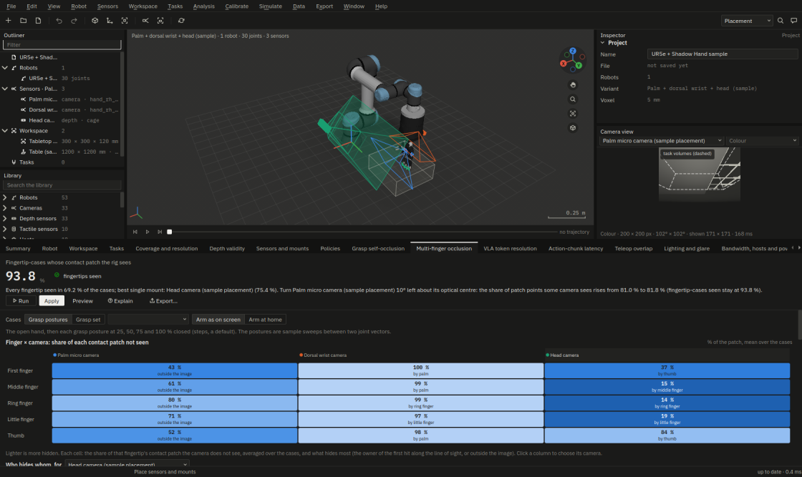

## ALOHA 2 (`--sample aloha`)

- **Robots:** the two ViperX 300 arms of Menagerie `aloha` (BSD-3-Clause), each a robot of its own ("ALOHA 2 left
  arm" is the primary robot, so the world is its base frame; "ALOHA 2 right arm" stands 0.938 m along x, turned half a
  turn, where `aloha.xml` puts it). Joint names are `aloha.xml`'s (`left/waist` … `right/right_finger`), so a
  14-value ALOHA recording is read onto each arm by name.
- **Gripper frames:** `left/gripper_base` and `right/gripper_base`; fingertips the two finger links of each.
- **Cameras (published):** `cam_high (overhead)`, `cam_low (worms-eye)`, `cam_left_wrist`, `cam_right_wrist`: four
  RealSense D405 at 848 × 480 (the ALOHA 2 paper), where Menagerie's model places them; the names are the ALOHA
  recordings' camera names.
- **Workspace:** the table of `scene.xml` (1.22 × 0.74 m), a tabletop volume between the arms and a handover zone
  above its middle (sample choices).
- **Tasks and policy (sample choices):** 100 tabletop grasps per arm, 60 bimanual handoffs from the left arm to the
  right one, a handover trajectory per arm, ACT, and two leader arms (the library's ALOHA WidowX-250 leader, joint to
  joint; the WidowX's own ranges are not stated, so the followers' are used).

### Tour

<!-- example: tour-aloha -->
1. `dexvantage --sample aloha`: 2 robots, 4 sensors (the four D405s), the table, a tabletop volume between the arms and
   a handover zone.

   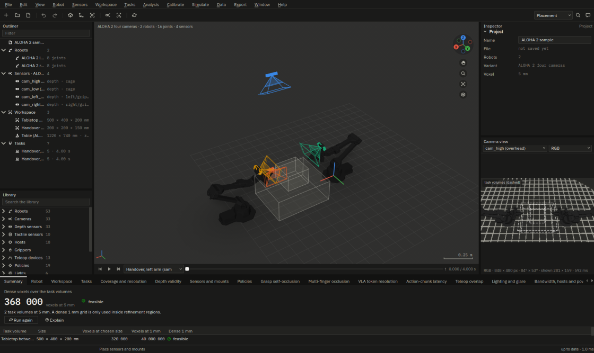

2. Select `cam_left_wrist` in the Outliner: the Camera view looks down past the left gripper's fingers.

   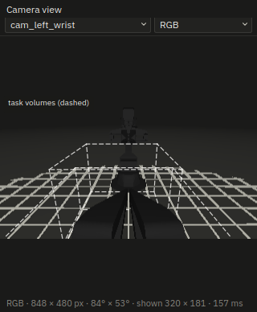

3. Coverage ▸ Run: "Task volume seen: 100 % (well covered)". Grasp self-occlusion ▸ Run (the left arm's tabletop
   grasps): "Contact visibility: 100 % (well seen)".
4. The rest of the specification's ten minutes (which grasps lose a fingertip and why, a moved camera, depth, VLA
   tokens, bandwidth, the MuJoCo and LeRobot exports and a printable bracket) is the user guide's
   [ten-minute tour](../user-guide.md#ten-minute-tour).

Measured on this build (2026-11-07, batch flags on the sample as it opens, RTX 5080): `--coverage` 99 % of the task
volume seen by two or more cameras; `--grasp` (the left arm's 100 grasps) 86 reachable, 14 out of reach, Contact
Visibility Score 100 %; `--teleop` 100 % teleoperable through both leader arms, the two arms' reach overlapping on
100 % of it, the handover zone reached by both on 100 % of its points with an arm-to-arm margin of 48.5 mm (the
fingers, at a 100 mm gap, a default); `--groundtruth` the MuJoCo render agrees with the grasp study on 87.1 % of the
contact points and the verdict on 43 of 43 grasps; `--handeye-plan` (cam_left_wrist, eye-in-hand) 20 poses meet the
0.5 mm and 0.05° default. `--vla-tokens` says "no task object": add one on the Workspace page to count its tokens.

## Franka Panda bimanual (`--sample panda-bimanual`)

- **Robots:** two instances of Menagerie `franka_emika_panda` (Apache-2.0, with the Franka Hand): there is no
  official bimanual Franka model. "Panda left (sample cell)" is the primary robot; "Panda right (sample cell)" stands
  0.8 m along −y, both facing +x (a sample layout).
- **Cameras (sample placements):** a wrist D405 on each hand, looking at the pinch point, and a front D435 looking
  back at the cell.
- **Tasks and policy (sample choices):** 100 grasps per arm (top-down, side, angled), 60 handoffs, a handover
  trajectory per arm, GELLO leaders from the library (same kinematics as the arm, Wu et al. 2023), Diffusion Policy.

### Tour

<!-- example: tour-panda-bimanual -->
1. `dexvantage --sample panda-bimanual`: 2 robots, 3 sensors (a wrist D405 on each hand and the front D435).

   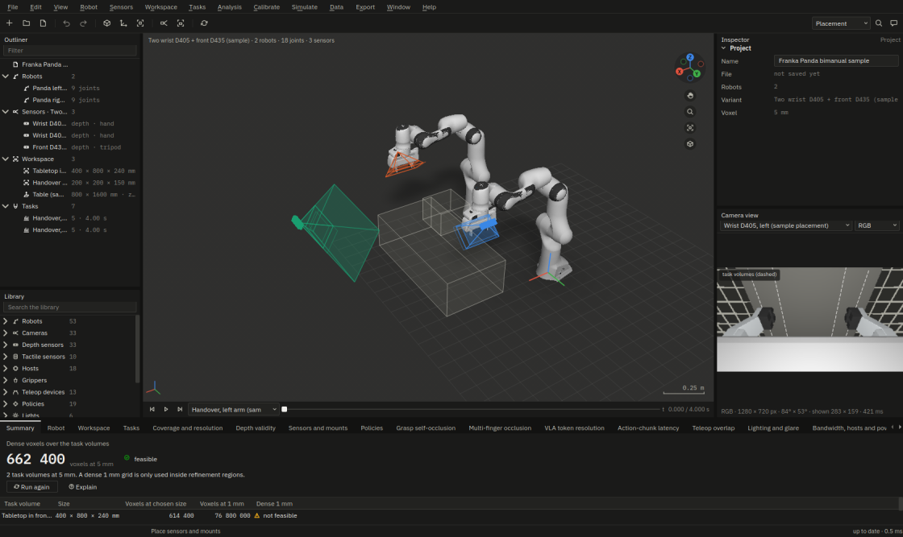

2. Turn the right arm's first joint on the Robot page: only that arm's wrist camera moves.
3. Coverage ▸ Run: "Task volume seen: 100 % (thin)". Grasp self-occlusion ▸ Run: "Contact visibility: 100 % (well
   seen)".
4. Teleop overlap ▸ Run for the bimanual block: each arm's reach through its GELLO leader, the overlap of the two arms
   and the handover zone (the measured figures are below).

   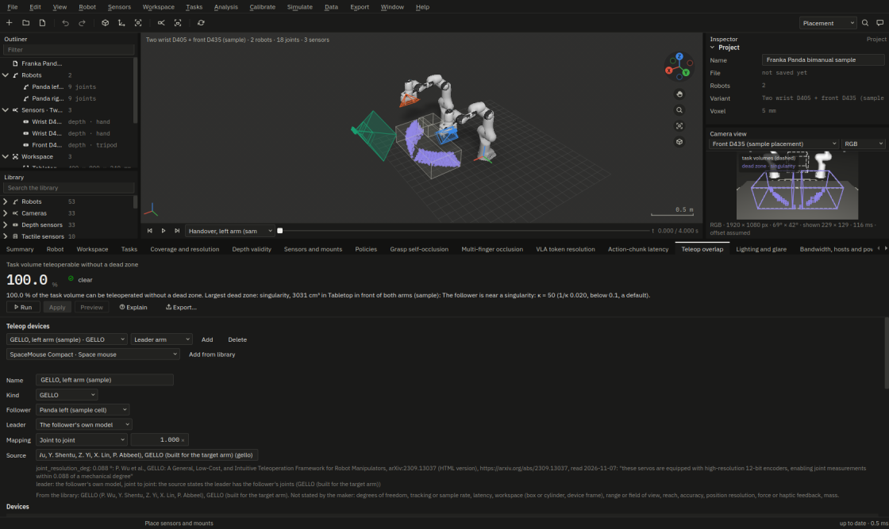

Measured: `--coverage` 79 % seen by two or more cameras (each wrist D405 sees 52 % at home; the front D435 all of
it); `--grasp` 76 of 100 reachable (24 out of reach), score 100 %; `--teleop` 100 % teleoperable, the arms' reach
overlapping on 79 %, a singularity dead zone of 3 031 cm³ named with its pose; the handover reads 0 % quality: at the
default 100 mm gap the two Franka Hands come within 0.6 mm of each other, so set a wider gap on the Teleop page (the
object you hand over) or move an arm. `--groundtruth` agrees on 91.0 % of contact points and 38 of 38 verdicts.

## Unitree G1 upper body (`--sample g1`)

- **Robot:** Menagerie `unitree_g1` `g1_with_hands.xml` (BSD-3-Clause), legs and waist held at its `stand` keyframe
  (their joints deleted in `g1_upper_body.xml`; all are 0 at `stand`), pelvis fixed 0.79 m above the floor. q is
  both arms and both three-finger hands, 28 joints in one state vector. **Its meshes are simplified** to fit the
  package, each within 0.5 mm of Menagerie's (measured; [samples.md](../models/samples.md#unitree-g1-upper-body-g1)):
  import the full model with Robot ▸ Import from MuJoCo Menagerie when that matters.
- **Gripper frame:** the right hand (`right_wrist_yaw_link`, which carries the palm); fingertips its thumb, index and
  middle distal links.
- **Camera (published):** "Head D435 (Unitree URDF d435_link)", on `torso_link` where Unitree's own URDF puts its
  `d435_link`, 47.6° down. Unitree's G1 page states only "Depth Camera+3D LiDAR"; the D435 is the model the frame's
  name gives.
- **Tasks and policy (sample choices):** a table under the hands, 100 right-hand grasps, one trajectory that moves
  both arms and closes the right hand, GR00T N1.5, and Apple Vision Pro hand tracking (as Unitree's xr_teleoperate drives
  the G1) with no tracking volume, because none is stated.

### Tour

<!-- example: tour-g1 -->
1. `dexvantage --sample g1`: 1 robot, 1 sensor (the head D435), both arms and both hands in one state vector.

   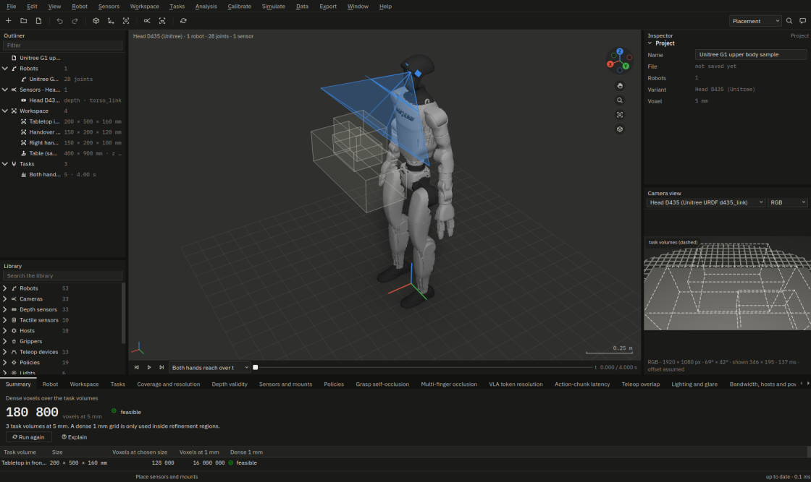

2. Select the head camera: the Camera view looks down at the hands over the table.

   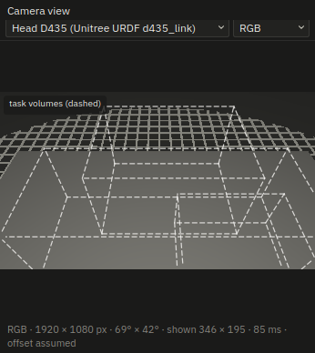

3. Coverage ▸ Run: "Task volume seen: 96.6 % (mostly single or blind)": one camera sees it, so the page suggests a
   second.
4. Grasp self-occlusion ▸ Run (the right hand's grasps): "Contact visibility: 0 % (blind at contact)": from the head,
   most contact points are behind their own finger at contact.
5. Analysis ▸ Multi-finger occlusion ▸ Run: "Fingertips seen: 25.9 %" of the fingertip-cases over the sample postures.

Measured: `--coverage` 97 % of the task volumes seen, all by the one camera ("add a second camera"); `--grasp` (the
right hand's 100 angled grasps) 79 reachable (20 at a joint limit), score 0 %: the head camera sees 38 % of the contact
points, most of the rest on the far side of their own finger, the result a head-only humanoid rig is expected to give;
`--dex-occlusion` (the hand over the table) 25.9 % of fingertip-cases seen, the index finger hiding its own pad;
`--handeye-plan` plans eye-to-hand (the board in the right hand: the head camera rides on a link no joint moves), 20
poses meet the default. `--canonical-view` and `--silhouette-calib` refuse in one sentence: they need a second, or a
static, camera; `--action-chunk` refuses because GR00T N1.5's control rate is not stated by its source.

## Other Menagerie robots

Robot ▸ Import from MuJoCo Menagerie… lists Menagerie's models (from GitHub, or a built-in list of names when
offline), downloads the one you pick into `XDG_DATA_HOME/DexVantage/menagerie/`, shows that model's own LICENSE and
imports it only after you tick "I accept the licence of this model". The robot records the licence, the Menagerie
commit and the date you accepted it, and the project keeps the LICENSE text.
