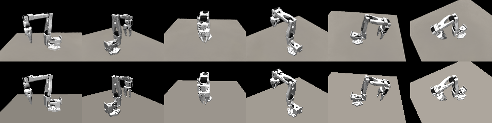

# Robot-aligned 3D Gaussian Splatting (spec §9.3, Phase 12)

`dexvantage/core/sim/splat_rig.py` (the robot-aligned scene) · `dexvantage/core/splat_raster.py` (the rasteriser) ·
`dexvantage/core/splat_reproject.py` (Gaussian scenes, reprojection, the .ply) · `dexvantage/core/gsplat_bridge.py`
(Nerfstudio and COLMAP input for outside trainers) · `dexvantage/core/sim/splat_views.py` and
`core/studies/splat_views.py` (splat views: the fit from a recorded episode, novel camera pose replay, perturbation
augmentation, the held-out quality; the **Splat views** page `ui/pages/splat.py`, `--splat`, `dv.splat`, the
assistant's `get_splat_views`) · measured by `scripts/splat_measure.py` and `scripts/splat_quality.py` · validation
checks `splat.*` (`validation/checks_splat.py`) · tests `tests/test_splat_rig.py`, `test_splat_raster.py`,
`test_splat_reproject.py`, `test_gsplat_bridge.py`, `test_splat_views.py`, `test_splat_ui.py` · worked example
[guide/splat.md](../guide/splat.md).

An optional extra: fitting needs PyTorch, and LPIPS the `lpips` package (`pip install "dexvantage[splat]"
--extra-index-url https://download.pytorch.org/whl/cu130`: torch 2.14.1, torchvision 0.29.1, lpips 0.1.4). Without it the rest of DexVantage is unchanged, and a fitted rig still renders
through the numpy reference rasteriser (slowly: small scenes).

The question: given posed images of the cell, can DexVantage show what a camera that was never built would see, at any
joint state, before the bracket is printed (novel camera pose replay), and render through the perturbed extrinsics of
§8.5 for augmentation? The approach is SplatSim's [qureshi2025_splatsim] and Robo-GS's [lou2025_robogs]: a 3D Gaussian
Splatting scene [kerbl2023_3dgs] whose robot Gaussians are segmented per link, stored in the link's frame and moved by
forward kinematics. Neither paper's code is used; the rasteriser is ported from Vantage.

## What it does

1. **Capture.** Views: an RGB image, its camera model (core/optics), its pose `T_world_optical` (the primary robot's
   base frame, REP-103; the optical frame is OpenCV's) and the joint state of every robot. Where available, a depth
   image and a per-pixel owner segmentation. A real capture takes its poses from the rig (`scenegeom.sensor_world_pose`
   at the logged q(t) for a link-mounted camera) and its masks from rendering the robot model at the logged q.
   `synthetic_capture` renders a bundled sample with MuJoCo instead, from a sphere of views round the robot;
   `capture_from_sensors` renders through the rig's own cameras. Both are marked synthetic.
2. **Initialisation.** Depth pixels are back-projected; each point takes its pixel's owner: a robot link (the point
   goes into that link's frame at the view's q) or the world. Points are thinned per frame to voxel centroids within a
   Gaussian budget (the robot's links get at least half, a default), shaped by their eight neighbours' principal
   components, coloured by their pixels.
3. **Fitting.** Adam on 0.8 L1 + 0.2 (1 − SSIM) [wang2004_ssim], one training view per step, the robot Gaussians posed by
   MuJoCo's forward kinematics at that view's q. Each Gaussian may move at most 1 cm and grow at most 3 × (defaults).
   No densification. Views k with k mod 8 = 4 are held out and scored before and after.
4. **Segmentation per link.** `masks` (default), `meshes` or `both`: see below.
5. **Re-posing and rendering.** `SplatRig.posed(project, q)` moves every link's Gaussians by `T_world_link(q)`;
   `render(project, camera, T_world_optical, q)` and `render_sensor(project, sensor_uid, q, extrinsic_delta)` draw
   them. Every render is marked `synthetic`.

## The rasteriser

Each Gaussian: centre μ, covariance Σ = R S Sᵀ Rᵀ, opacity o, colour. The centre goes through the lens model; the
covariance through the projection's Jacobian J at the centre, by central differences (the EWA approximation
[zwicker2001_ewa]): Σ₂ = J Σ_c Jᵀ + 0.3 I px². Front-to-back compositing per 16 × 16 tile, sorted by range:
αᵢ = min(0.99, oᵢ exp(−½ dᵀ Σ₂⁻¹ d)), dropped below 1/255, C = Σ cᵢ αᵢ Tᵢ + T_N · background. Every DexVantage lens
model works: pinhole, Brown-Conrady, Kannala-Brandt, equidistant, equisolid, stereographic.

A Gaussian reaches a pixel only inside the ellipse dᵀ Σ₂⁻¹ d ≤ m², m = min(3, √(2 ln 255 o)). With this cut-off the image
does not depend on the tiling, so a numpy reference written without tiles can be compared with it exactly. 3DGS lets a
Gaussian reach every pixel of the tiles its bounding square touches.

Three back ends: **torch** (CUDA, or the CPU), **numpy** (the reference) and **gsplat** [ye2025_gsplat] (pinhole only,
when it is installed: `scripts/build_gsplat.sh` builds it from source, see Environment). The fit and the splat views
study always render through torch; `auto` takes gsplat for other pinhole renders when it runs.

| Agreement on 300 fixed Gaussians, 64 × 48 | pinhole | Kannala-Brandt | Brown-Conrady |
|---|---|---|---|
| torch CPU float64 against numpy (largest colour difference) | 3.3 × 10⁻¹⁶ | 2.0 × 10⁻¹⁴ | 3.3 × 10⁻¹⁶ |
| torch CUDA float32 against numpy | 1.06 × 10⁻⁵ | 1.30 × 10⁻⁵ | 1.22 × 10⁻⁵ |

The CUDA difference is float32 round-off in the finite-difference Jacobian. The tests allow 10⁻⁹ (CPU) and 10⁻⁴ (CUDA).

gsplat 1.5.3 (built with `scripts/build_gsplat.sh`) against the torch path on the same 300 Gaussians through the
pinhole, on CUDA (2026-11-08, RTX 5080): mean colour difference 8.7 × 10⁻⁴, largest 0.113, 1.5 % of the pixels
differ by more than 0.01. The large differences are where gsplat's rules differ from this module's: gsplat sorts by
camera z and lets a Gaussian reach every pixel of the tiles its 3σ square touches, where this module sorts by range
and cuts each footprint at its 1/255 contour. `test_gsplat_agrees_with_the_torch_path` holds the mean below 0.01.
The gradients are checked against finite differences (`torch.autograd.gradcheck`, double precision).

## Reconstruction quality (measured, synthetic)

`scripts/splat_measure.py --out out/splat/measure.json` (2026-11-08, RTX 5080, torch 2.14.1+cu130, CUDA path).
Settings: 48 MuJoCo views at 160 × 120 px, 3 joint states (home plus 2 drawn within ±0.4 rad), 1,500 steps,
a 20,000-Gaussian budget, seed 0. Total run 2 min 16 s, peak resident memory 3.0 GB.

| Sample | Gaussians | Fit | Held-out PSNR before → after | SSIM before → after | Training views after |
|---|---|---|---|---|---|
| SO-100 | 16,940 | 60.2 s | 15.9 → 23.1 dB | 0.485 → 0.937 | 24.3 dB |
| UR5e | 18,666 | 61.9 s | 20.3 → 26.5 dB | 0.580 → 0.957 | 27.1 dB |

The "before" figures are those of the rig as the fit starts, with its colours and background held inside
[0.01, 0.99] for the optimiser. A first version scored the fitted rig the same way, which clamped its learnt black
background to 0.01 and cost the held-out SSIM a third (0.812 and 0.705 then, with the same PSNR): the luminance term
of SSIM on a dark flat region, (2 μx μy + C1) / (μx² + μy² + C1), is 0.5 for μx = 0.01 against μy = 0. The fitted rig
is now scored as fitted (`tests/test_splat_views.py` holds the fit report to the rig's own renders).

**Re-posing.** The fitted rig was posed at 6 joint states the capture never showed and rendered from 6 new poses. It was
compared with MuJoCo's render of the same scene, and with the same poses at the capture's first joint state:

| Sample | Unseen joint states: PSNR, SSIM | Captured joint state: PSNR, SSIM |
|---|---|---|
| SO-100 | 24.4 dB, 0.951 | 24.4 dB, 0.950 |
| UR5e | 25.9 dB, 0.957 | 26.9 dB, 0.965 |

Re-posing to an unseen q costs nothing measurable on SO-100 and 1.0 dB on UR5e. (The first version of this page found
these SSIMs higher than the held-out views'; that was the scoring clamp described above.)

These figures are for **synthetic captures**: MuJoCo's shading, exact poses, exact masks. A real capture adds pose and
calibration error, exposure changes and real texture, and will score lower. On a real cell, report PSNR and SSIM on
held-out real frames (the fit report gives them). LPIPS is measured by splat views (below).

## Segmentation per link

The truth: every Gaussian starts from back-projected pixels of MuJoCo's per-pixel owner segmentation, grouped per
owner, so its starting label is exact. "Moving" counts a confusion only when it changes a re-posed render: the base
link does not move with q (`static_frames`), so base-versus-world confusions are not counted there. Rates are shares of
all Gaussians.

| Case | Method | SO-100: all, moving | UR5e: all, moving | Wrong labels undone (SO-100, UR5e) |
|---|---|---|---|---|
| Starting rig | masks | 0.22 %, 0.17 % | 0.18 %, 0.16 % | |
| | meshes | 0.79 %, 0.25 % | 0.41 %, 0.14 % | |
| After the fit | **masks** | 1.56 %, **0.98 %** | 0.77 %, **0.75 %** | |
| | meshes | 2.19 %, 1.92 % | 2.92 %, 2.78 % | |
| | both | 2.47 %, 1.84 % | 2.34 %, 2.28 % | |
| After the fit, 10 % of the labels made wrong | masks | 4.32 %, 3.51 % | 3.70 %, 3.66 % | 71 %, 70 % |
| | meshes | 2.19 %, 1.92 % | 2.92 %, 2.78 % | 98 %, 97 % |
| | both | 2.63 %, 1.96 % | 2.42 %, 2.36 % | 96 %, 97 % |

(The second run of `splat_measure.py`, after the scoring fix; the fit is the same code, and the rates differ from the
first run's by the CUDA fit's run-to-run variation, at most 0.12 point.)

**The choice.** `masks` is the default (`segment='auto'` uses it when the capture has masks and depth). It votes with
each Gaussian's centre where it lies on the surface its pixel sees: within 1 mm plus the Gaussian's largest σ of the
pixel's depth (defaults). It has the lowest rate on a fitted rig, which is when segmentation runs. It also follows what
the images show: a cable or label the robot model lacks gets the owner of the pixels it sits on.

`meshes` labels each Gaussian with the nearest link mesh within 1 cm. It needs no images and undoes deliberately wrong
labels better, because a wrong label poses a Gaussian away from every surface in the views at other joint states, so
masks cannot vote for it. It mislabels where links meet each other or the table, and loses Gaussians the fit moved off
the mesh. On UR5e this is 2.8 % after the fit. `both` uses masks, then meshes for the Gaussians no view voted for.

A first version voted with each pixel's dominant Gaussian in a render. On SO-100 (24 views at 96 × 72) it left 44 % of
the Gaussians without a vote and undid 49 % of the wrong labels, so it was replaced.

## Splat views: replay, augmentation and the held-out quality

`core/sim/splat_views.py` builds the product on the rig: the `splat_views` study (the **Splat views** page, `--splat
fit`, `dv.splat.fit`, the assistant's `get_splat_views`), novel camera pose replay (`--splat replay`,
`dv.splat.replay`) and perturbation augmentation (`--splat augment`, `dv.splat.augment`). Every setting is a labelled
default (`splat_views.DEFAULTS`).

**Where the rig comes from** (setting `source`):

- `episode`: one episode of a recorded dataset (the LeRobot reader, `core/datasets`). Each enabled camera the episode
  records gives 24 frames (`views_per_camera`), chosen farthest apart in joint space, resized to 160 px wide (area
  averaging). A view's pose is the camera's mount at the frame's logged q, `scenegeom.sensor_world_pose`, so a wrist
  camera moves with the arm; its lens is the dataset's intrinsics when stored, else the project's imager; its depth
  and per-pixel owner masks are MuJoCo renders of the project's model at that q (`core/sim/render.py`). The episode
  must give at least 8 camera poses 2 cm or 5° apart (`min_views`, `view_sep_m`, `view_sep_deg`, greedy count);
  otherwise the study refuses ("the episode has too few distinct views"). A dataset DexVantage generated (it carries
  `dexvantage_truth.json`) is marked synthetic.
- `demo`: `splat_rig.synthetic_capture` of the project (48 MuJoCo views at 160 × 120 px, 3 joint states), a
  demonstration on the project's model, labelled synthetic everywhere.
- `rig`: a saved rig file; its quality is its own fit report's.
- `auto` (the default): the episode when a dataset is named, else the demonstration.

The fit is `fit_splat_rig` (1,500 steps, a 120 s budget, 20,000 Gaussians, seed 0, defaults) on CUDA; without a CUDA
device the study refuses unless `device` is `cpu`, and without PyTorch it says the splat extra is not installed. The
fitted rig is cached in `XDG_CACHE_HOME/DexVantage/splat/`, keyed by the project's content, its robots, the source and
the fit settings, so replay and augment reuse it.

**Quality on frames the fit did not use.** Held-out views: views k with k mod 8 = 4, left out of the fit and rendered
at their pose and q. Held-out joint states: for `demo`, 4 (here 6) joint states drawn within ±0.4 rad of home with
another seed, from new poses, against MuJoCo's renders; for `episode`, per camera the 4 (here 6) frames whose joint
vector is farthest (max-norm) from every frame of that camera used in the fit. Scores, on images in [0, 1]:

- PSNR = 10 log10(1 / MSE), over every pixel and channel (and, as "robot PSNR", over the pixels the model's mask
  gives to the robot);
- SSIM [wang2004_ssim]: an 11 × 11 Gaussian window of σ 1.5, K1 = 0.01, K2 = 0.03, the mean over pixels and
  channels (`splat_raster.ssim_np`; checked against scikit-image and closed forms, below);
- LPIPS [zhang2018_lpips]: the `lpips` package's AlexNet model with its v0.1 linear layers, images scaled to
  [−1, 1]. The AlexNet backbone needs torchvision's ImageNet weights (`alexnet-owt-7be5be79.pth`, 244 MB, from
  download.pytorch.org, distributed by the PyTorch project); they are not bundled and are downloaded only when asked
  (`lpips_download`, the page's **Get LPIPS weights…**, `dv.splat.fetch_lpips_weights()`), into
  `XDG_CACHE_HOME/DexVantage/torch`; the file's SHA-256 is checked against the 7be5be79 its name carries. DexVantage
  loads them into `lpips.LPIPS(net='alex', pnet_rand=True)` itself, so the package never downloads on its own; the
  result equals the package's own `LPIPS(net='alex')` to 10⁻⁶ (`test_lpips_matches_the_lpips_package`). Without the
  weights LPIPS is None and the document says why.

The headline is the held-out views' PSNR with a status against 25, 20 and 15 dB (`psnr_good_db`, `psnr_warn_db`,
`psnr_serious_db`: DexVantage defaults, not standards).

**Measured** (`scripts/splat_quality.py --out out/splat/quality.json`, 2026-11-08, RTX 5080, the study's defaults,
`holdout_q` 6; 3 min 16 s for both samples, peak resident memory 3.7 GB). The episodes are DexVantage's own synthetic
recordings (`core/sim/episodes.py`: one episode, no faults, its default 1 DN pixel noise, at most 320 px wide, H.264:
80 rows on the SO-100, 136 on the UR5e), so every figure is synthetic.

| Sample, source | Fit | Held-out views: PSNR, SSIM, LPIPS (robot PSNR) | Held-out joint states: PSNR, SSIM, LPIPS |
|---|---|---|---|
| SO-100, demo | 60.3 s, 16,936 Gaussians | 23.1 dB, 0.936, 0.076 (14.9 dB), 6 views | 24.4 dB, 0.951, 0.062, 6 |
| UR5e, demo | 62.0 s, 18,665 | 26.5 dB, 0.957, 0.056 (20.1 dB), 6 | 25.9 dB, 0.957, 0.055, 6 |
| SO-100, episode | 29.4 s, 12,328 | 32.4 dB, 0.975, 0.022 (25.6 dB), 6 | 33.3 dB, 0.977, 0.015, 12 |
| UR5e, episode | 20.8 s, 12,521 | 31.7 dB, 0.969, 0.028 (31.4 dB), 6 | 30.2 dB, 0.960, 0.022, 12 |

**Run to run.** A CUDA fit does not repeat bit for bit, so these figures move between runs of the same settings and
seed. Measured (2026-11-08, the review of this page; `scripts/splat_quality.py` again, then three more fresh fits of
each episode): the SO-100 episode's held-out views read 32.4 to 32.8 dB, SSIM 0.975 to 0.976, LPIPS 0.018 to 0.022
over 5 fits; the UR5e episode's 31.7 to 33.3 dB, SSIM 0.969 to 0.975, LPIPS 0.020 to 0.028 over 5 fits (the table
gives the first). The SO-100 demonstration read 23.1 dB again; the proposed-pose and spread tables below moved by at
most 0.8 dB, 0.016 SSIM and 0.034 LPIPS. Fit times depend on what else uses the GPU: the second run's UR5e
demonstration, on a GPU another program kept busy, reached its 120 s budget after 1,451 of the 1,500 steps (26.4 dB).

The episode fits score higher than the demonstrations because their views are the rig's own two cameras at the
poses they record from: the held-out frames are close to the training frames. The robot's pixels score lower than the
whole image (the background is a flat colour that is easy to fit).

**A proposed camera pose.** The rig through the wrist camera moved back along its own x axis and sideways along y, at
4 joint states, against MuJoCo's render through the same moved camera (160 px wide; PSNR dB, SSIM, LPIPS):

| Rig, joint states | as mounted | 2 cm back | 5 cm back | 10 cm back | 2 cm sideways | 5 cm sideways |
|---|---|---|---|---|---|---|
| SO-100 episode, at 4 of its own | 26.2, 0.944, 0.054 | 17.9, 0.790, 0.149 | 15.8, 0.664, 0.207 | 13.4, 0.586, 0.336 | 19.2, 0.788, 0.136 | 19.4, 0.763, 0.149 |
| UR5e episode, at 4 of its own | 28.1, 0.948, 0.064 | 17.5, 0.804, 0.084 | 15.0, 0.715, 0.146 | 13.6, 0.685, 0.213 | 19.5, 0.839, 0.095 | 19.4, 0.806, 0.138 |
| SO-100 episode, 4 drawn within ±0.4 rad | 16.7, 0.712, 0.277 | 14.6, 0.597, 0.332 | 13.5, 0.520, 0.373 | 11.2, 0.420, 0.493 | 15.9, 0.628, 0.316 | 16.7, 0.641, 0.338 |
| UR5e episode, 4 drawn within ±0.4 rad | 15.2, 0.710, 0.230 | 13.6, 0.598, 0.269 | 12.9, 0.558, 0.288 | 12.4, 0.611, 0.295 | 14.5, 0.666, 0.253 | 14.3, 0.654, 0.266 |
| SO-100 demo, 4 drawn within ±0.4 rad | 17.9, 0.822, 0.189 | 17.7, 0.831, 0.180 | 14.8, 0.699, 0.257 | 13.9, 0.614, 0.393 | 17.2, 0.810, 0.178 | 17.0, 0.837, 0.173 |
| UR5e demo, 4 drawn within ±0.4 rad | 16.9, 0.654, 0.284 | 14.5, 0.489, 0.292 | 16.9, 0.655, 0.239 | 19.8, 0.799, 0.168 | 16.7, 0.662, 0.303 | 17.2, 0.708, 0.274 |

So a proposed camera 2 cm from every captured view already loses 8 to 11 dB: it sees surfaces no view saw (the wrist
camera's views of an episode all keep one offset to the gripper). A proposed view shows the layout (what enters and
leaves the frame, where the gripper and the object sit) far better than the detail. The rig is good where the episode
looked: the same wrist camera, unmoved, at joint states the episode never reached scores 15 to 17 dB. The
demonstration's sphere of views does not contain a wrist camera's close view either (17 dB unmoved); on the UR5e its
score rises when the camera moves 10 cm back, towards the sphere's distances.

**Joint states far from the capture** (the demonstration rigs, captured within ±0.4 rad; 4 new joint states from new
poses, against MuJoCo; PSNR dB, SSIM, LPIPS):

| Spread of the joint states | ±0.2 rad | ±0.4 rad | ±0.8 rad | ±1.2 rad |
|---|---|---|---|---|
| SO-100 | 24.3, 0.951, 0.060 | 24.1, 0.950, 0.062 | 22.5, 0.926, 0.071 | 21.7, 0.919, 0.080 |
| UR5e | 26.9, 0.966, 0.045 | 26.8, 0.964, 0.043 | 26.1, 0.957, 0.046 | 26.0, 0.958, 0.050 |

**A real recording.** None is in the repository or its test data. A LeRobot dataset stores no camera extrinsics
(the reader leaves them None), so a real recording's views are posed at the project's planned mounts, and its mounts
would first need measuring (the silhouette calibration) for the figures to describe the method rather than the
calibration. No real recording was downloaded and none is measured; the figures above are all synthetic.

**Novel camera pose replay** (`replay`): every state row of the episode (or `replay_max_frames`), its joint state
interpolated to the row's time (`render_calib.q_at`, joints matched by name, `core/datasets/joints`), rendered through
the proposed target camera at `replay_scale` of its stream size. It writes `<out>/splat_replay_synthetic/`:
`<camera>_replay_synthetic.mp4` (encoded as the LeRobot writer encodes: `available_codec` (AV1 by libsvtav1, else
H.264), the same encoder options and the one-thread re-encode of an AV1 file that does not decode; then decoded again
and refused unless every frame decodes), `frames/frame_NNNNNN_synthetic.png` and `dexvantage_splat_manifest.json`
(schema `dexvantage.splat_replay/1`: `"synthetic": true`, the camera's proposed pose and its first optical frame,
the source episode, the rig's quality, every file's SHA-256 and the provenance block). The files say it themselves
too, so one copied out of the folder still does: each PNG carries a `tEXt` `Comment` and the MP4 a container
`title` and `comment` ("synthetic: a DexVantage splat render …"; the video's packets are copied unchanged into the
marked file, which is kept only when every frame's time and decode are the same). Measured by
`scripts/splat_quality.py --files` (2026-11-08, RTX 5080 shared with other work, the rig loaded from the cache, AV1):
the SO-100 episode's 80 rows at 1280 × 720 through the wrist camera took 6.3 s, rendering 15.3 frames a second
including the PNGs; the UR5e's 136 rows 11.6 s, 14.2 frames a second. (A first, hand-timed run on the SO-100 read
5.7 s and 17.1 frames a second.) Every PNG's `Comment` and the MP4's `comment` were read back as synthetic.

**Perturbation augmentation** (`augment`): `augment_n` copies (default 4, at most 100) of the episode; in copy i every
recorded camera is re-rendered at its own timestamps through its mount perturbed by draw i of
`core/tolerance.perturbed_extrinsics` (the §8.5 draws the `perturbations` exporter writes for the same seed, scale and
distribution; the test compares them), at `augment_frame_scale` of the recorded size. The joint states, actions and
task are the episode's. It writes a LeRobot dataset (`write_lerobot`, v3.0 by default) in
`<out>/splat_augment_synthetic/`, then marks it: `meta/info.json` gains `"dexvantage": {"synthetic": true, "kind":
"splat render …", "source_dataset", "source_episode", "capture_synthetic", "manifest"}` and every video feature's info
`"dexvantage.synthetic": true` (LeRobot's DatasetInfo warns about keys it does not know and leaves them out of its
object; the file keeps them); every MP4 of the dataset carries the same container `title` and `comment` as the
replay's; `dexvantage_splat_manifest.json` (schema `dexvantage.splat_augment/1`) lists each copy's draw per camera,
the tolerance sources, the rig's quality, every file's SHA-256 and the provenance. Opened again in DexVantage (a
splat fit to it, say), the dataset is synthetic ("splat renders: synthetic, not a recording"): `splat_marked` reads
those marks. Each camera is rendered through its imager at the sensor's chosen stream, the mode the capture's MuJoCo
views use (`splat_rig.stream_imager`). Measured by
`scripts/splat_quality.py --files` (as for the replay): the SO-100 episode's 4 copies (320 rows, two cameras at
320 × 180, the samples' mount tolerances ±1 mm and ±0.5° per axis, uniform) took 10.4 s, the UR5e's (544 rows)
20.5 s (a first, hand-timed SO-100 run: 9.1 s); `info.json`, every MP4 and the dataset opened again all read as
synthetic.

**Validation** (`validation/checks_splat.py`, model `splat`, 7 checks; full run 2026-11-08):

| Check | Reference | Tolerance | Measured |
|---|---|---|---|
| `splat.footprint_closed_form` | one Gaussian's EWA footprint written out | 10⁻¹² | 6.2 × 10⁻¹⁵ |
| `splat.raster_torch_cpu` | the numpy rasteriser (no tiles), float64 | 10⁻⁹ | 2.0 × 10⁻¹⁴ |
| `splat.raster_torch_cuda` | the same, CUDA float32 (left out without a CUDA device) | 10⁻⁴ | 1.3 × 10⁻⁵ |
| `splat.reproject_disparity` | u_r = u_l − f b / z on a rectified pair | 10⁻⁹ px | 1.8 × 10⁻¹³ px |
| `splat.repose_rigid` | render(T · G, C) = render(G, T⁻¹ · C), T from the model's link_pose | 10⁻⁵ | 5.9 × 10⁻⁷ |
| `splat.ssim_closed_form` | SSIM of constant images, (2ab + C1)/(a² + b² + C1); PSNR of a constant difference | 10⁻¹² | 2.4 × 10⁻¹³ |
| `splat.ssim_vs_skimage` | scikit-image's structural_similarity set to Wang et al.'s (needs the test extra) | 10⁻⁹ | 0 |

The re-posing tolerance is float32's: a GaussianSet holds float32 arrays, so centres about 0.3 m from the camera round
to about 3 × 10⁻⁸ m, a shift of 10⁻⁵ px. Both SSIM implementations filter with scipy.ndimage's Gaussian, so they agree
to the bit on the interior; the check holds the window, the constants and the covariance normalisation to Wang et
al.'s. No check covers the fit's quality: it depends on the capture, and its figures are measured above.
`dexvantage --self-test` runs four of them on its `splat` line ("splat extra not installed" without PyTorch).

Fit time, render rate and GPU memory on this machine: [performance.md](../performance.md#splat-views-fit-time-render-rate-and-gpu-memory).

## Environment (measured 2026-11-08)

- **PyTorch.** The official index has Python 3.14 (cp314) wheels from 2.9.0 on, in its cu128 and later builds. Two
  were tried, and both list sm_120 (Blackwell) kernels: 2.13.0+cu129, then 2.14.1+cu130. Installed: `torch==2.14.1+cu130` from https://download.pytorch.org/whl/cu130 (`torch.cuda.get_arch_list()`: sm_75,
  sm_80, sm_86, sm_90, sm_100, sm_120) with its NVIDIA runtime wheels (CUDA runtime 13.0.96, cuDNN 9.24, Triton 3.8.0).
  It runs on the RTX 5080 (driver 595.99, CUDA 13.2). Installed size of the extra, with torchvision 0.29.1+cu130 and
  lpips 0.1.4 since splat views: 4,689 MB (`packaging/release.py extras`); torch alone was 4,644 MB over 19
  distributions (10⁶-byte MB from
  their RECORD files, `packaging/release.py extras`): torch 1,208 MB, cuDNN 966 MB, Triton 938 MB, cuBLAS 597 MB, and
  the rest. `du` saw the environment folder grow from 2.5 GiB to 7.7 GiB, which includes the bytecode caches.
- **gsplat.** No published build installs here, so `scripts/build_gsplat.sh` builds it from source:
  - 1.5.3 is the latest release on PyPI and GitHub (July 2025). It ships prebuilt wheels only up to CPython 3.10 and
    PyTorch 2.4 (https://docs.gsplat.studio/whl/), so on Python 3.14 it compiles its CUDA code.
  - The CUDA 12 `nvidia-cuda-nvcc-cu12` wheels (12.8.93, 12.9.86) contain `ptxas` but no `nvcc`. The CUDA 13
    `nvidia-cuda-nvcc` wheels do contain it.
  - nvcc 13.0.88, which matches torch's CUDA 13.0, fails on this machine's glibc 2.43. Its `math_functions.h`
    declares `rsqrtf` with an exception specification glibc's does not have. nvcc 13.2.86, with its matching runtime
    headers and CCCL in a separate build folder (not in the environment), compiles and runs an sm_120 kernel.
  - gsplat 1.5.3's PyPI source archive lacks its glm submodule (the GitHub tag has it), and its `setup.py` forces
    `-std=c++17`, which torch 2.14's headers reject: they need C++20 (`std::strong_ordering` in `c10/util/intrusive_ptr.h`).
  - `scripts/build_gsplat.sh` clones the v1.5.3 tag with its submodules (commit 937e299), changes that one flag to
    `-std=c++20`, and builds with nvcc 13.2.86 and its matching CUDA 13.2 wheels kept in a throw-away folder
    (`out/gsplat-build`; nothing system-wide), for compute capability 12.0 (`ARCH`). It was run on this machine on
    2026-11-08 and gsplat 1.5.3 imports and renders on the RTX 5080. gsplat is Apache-2.0 (its LICENSE), its glm
    submodule MIT; it is not bundled and not in an extra (pip cannot build it).

  The fitting path is the plain-torch rasteriser either way (gsplat's backward pass is not used); on this machine it
  fits a 17,000-Gaussian, 160 × 120 scene at about 42 ms per step. A render, measured with gsplat installed
  (640 × 480 pinhole, random Gaussians, mean of 10 after 3 warm-ups, including the copy back to numpy; the test suite
  ran at the same time, so these are upper bounds): 20,000 Gaussians 28.8 ms through torch, 1.1 ms through gsplat;
  100,000 Gaussians 41.6 ms and 2.4 ms. Without gsplat the gsplat test skips with the reason.
- **Tests.** The fitting tests run on the CPU (32 × 24 px, 10 views, at most 300 Gaussians, 12 steps, float64, about 2 s).
  The CPU path repeats bit for bit; the CUDA path does not (atomic adds in the backward pass). The CUDA tests skip with
  the reason where there is no CUDA, and the rendered ones where MuJoCo cannot render offscreen.

## Files

- `rig.save('cell.splat.npz')` writes `cell.splat.npz` and `cell.splat.json`.
  - The `.npz` holds `means`, `scales`, `quats` (x, y, z, w), `opacity`, `colours`, `frame` and `background`.
  - The `.json` sidecar has schema `dexvantage.splat_rig/1`. It lists the links each frame index names, `q_ref`, each
    robot's name and file digest (`check_robots` refuses a robot whose files changed), `synthetic`, the fit report and
    the provenance (project digest, environment).
  - A robot Gaussian's mean and rotation are in its link's frame; a world Gaussian's are in the world.
- `rig.ply_bytes(project, q)` is the scene posed at q as a standard 3DGS `.ply` (the INRIA layout: opacity as a logit,
  log scales, rot_0..3 = w, x, y, z, colour as the degree-0 SH coefficient, f_rest zero).
- `gsplat_bridge.export_nerfstudio` and `export_colmap` write a capture for outside trainers (Nerfstudio's splatfacto,
  the INRIA code, gsplat's trainer). Pixel centres are corner-based there (cx + ½). `read_trained_ply` reads their
  result back.

## Known limits

- No densification and no view-dependent colour.
- No exposure or lighting model: a re-posed link keeps the shading it was captured with.
- A joint state far from every captured one shows surfaces no view saw.
- Objects the robot moves are world Gaussians, so they stay where they were captured.
- The masks' quality bounds the segmentation; a calibration error shifts the masks.
- The torch rasteriser composites per tile in Python-level blocks, not in one fused CUDA kernel as gsplat does: a
  640 × 480 render is about 17 to 26 times slower than gsplat's (Environment). The fit still uses it, because its
  footprint and order rules are the ones the numpy reference checks.
- Every quality figure on this page is from synthetic captures (MuJoCo renders, of the model whose depth and masks
  the fit also uses); no real recording has been measured (see Splat views, above). None of them says how a real
  cell would score.
- A CUDA fit does not repeat bit for bit, and the figures move with it (Reconstruction quality, above).
- Quality falls for a camera a few centimetres from every captured view and for joint states far from the capture
  (measured above), on specular and transparent surfaces (MuJoCo's samples have none, so this is not measured here)
  and in regions no view saw.
